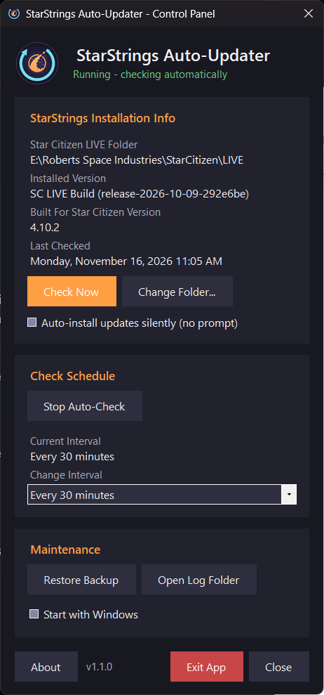
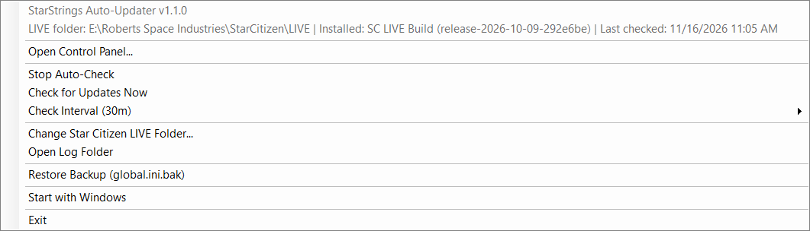

# StarStrings Installer & Auto-Updater

A Windows tray app for [MrKraken's StarStrings](https://github.com/MrKraken/StarStrings) that
installs the `global.ini` localization pack for **Star Citizen LIVE** if you don't have it
yet, and keeps it current after that.





It watches the StarStrings releases page in the background, and when a new version shows up
it grabs `StarStrings-LIVE.zip`, pulls out `global.ini` (plus `user.cfg` if you don't have one
already), and drops them into your Star Citizen LIVE folder, but only after checking with you
first.

## What it does

- **Double-click the tray icon to pull up the Control Panel.** It's a dark dashboard with
  pretty much everything on one screen: current status, your LIVE folder, what version is
  installed and which Star Citizen patch it targets, when it last checked, a Check Now button,
  the check schedule, backup/log tools, Start with Windows, an About button, and Exit. It
  updates live, so you don't need to close and reopen it to see changes take effect.
- Sits quietly in the tray and starts itself when you log into Windows.
- Has its own icon (MrKraken's StarStrings mark wrapped in a sync arc) for the tray, the exe,
  and the Control Panel. It goes gray when auto-checking is paused.
- Checks for a new StarStrings release every 30 minutes by default. Change that from the tray
  menu's Check Interval submenu: 30 min, 60 min, 3 hr, 12 hr, daily, or set your own custom
  interval.
- Finds a real update? You get a dialog with the release notes and an Install Now / Skip
  choice. Or, if you've ticked **Auto-install updates silently** in the Control Panel, it just
  installs it and gives you a quick heads-up afterward instead of asking first.
- Backs up your current `global.ini` to `global.ini.bak` before overwriting it, and you can
  restore that backup from the tray menu whenever you want.
- Won't touch an existing `user.cfg`. It only drops in the bundled one if you don't have one
  yet.
- Logs everything under `%AppData%\StarStringsAutoUpdater\logs\`: a general `update.log` for
  checks/downloads/errors, and a `version-history.log` that records every version it's
  actually installed, with a timestamp and the zip's hash.
- Also keeps an eye out for new releases of itself, on the same schedule, and offers to grab
  them for you.
- Shows the running app version right in the tray menu and tooltip.
- Everything's also reachable from the tray icon's right-click menu: Open Control Panel,
  Start/Stop Auto-Check, Check for Updates Now, Check Interval, Change LIVE Folder, Open Log
  Folder, Restore Backup, Start with Windows, Exit.

## How it knows there's a new version

StarStrings' own release workflow deletes and recreates its `latest` tag on every push to
`master`, so the tag name never changes, only the timestamp, name, and zip contents do. So
instead of comparing tags, this app checks:

1. Has the release's publish timestamp changed since the last one we installed? If not, nothing
   to do.
2. If it has, download the zip and compare its hash to the last one installed. Same hash means
   it got republished with no real changes, so it quietly updates its records without bugging
   you.
3. Different hash means it's genuinely new, and that's when you get the install prompt.

If you skip a version, it won't ask again about that exact one on its own, but "Check for
Updates Now" will always re-ask regardless.

## Figuring out the Star Citizen patch version

StarStrings doesn't put the Star Citizen patch it targets anywhere in the release itself, so
the Control Panel's "Built For Star Citizen Version" field comes from reading the StarStrings
repo's `readme.md`, which states it in CIG's own build format (something like
`sc-alpha-4.10.1_live_12660092`). That's a plain file fetch, not an API call, so it doesn't eat
into any rate limits. It runs right after an install, and also as a one-time catch-up check if
that field was never filled in before. Shows "Unknown" until that first successful lookup, or
if StarStrings ever changes how it states the version.

## Restoring a backup

Every install backs up whatever `global.ini` was already there to `global.ini.bak` (just the
one rolling backup, not a history of them). Restore Backup in the tray menu puts that file back;
it's grayed out if there's no LIVE folder set or no backup sitting there.

Restoring also resets what the app thinks is currently installed, since the file on disk no
longer matches. So the next check treats the latest release as new again and offers to put it
back, instead of assuming nothing changed.

## Keeping the app itself updated

On the same schedule as the content checks, it also checks GitHub for a newer release of
itself. This repo uses normal version tags, so it's just a straightforward "latest release"
lookup compared against the running build.

Found something newer? You get a prompt with the release notes and a Download button. It won't
replace the running exe in place. Windows won't allow that anyway, so instead:

1. The new exe downloads to `%AppData%\StarStringsAutoUpdater\updates\`.
2. You're asked whether to restart into it now. Say yes and it launches the new version as its
   own process, exits the old one, and the new instance takes over the "start with Windows"
   registration so future logins launch the right version.
3. Say no (or just close the prompt) and the new exe just sits in the updates folder until
   you're ready, and it won't ask about that same version again.

Each release's exe has its version in the filename, like `StarStringsAutoUpdater-v1.2.0.exe`,
so you can tell builds apart at a glance.

## Running it

1. Run `StarStringsAutoUpdater.exe`. No installer, it's a single portable file.
2. First launch, it'll ask for your Star Citizen **LIVE** folder, the one with
   `data\Localization\english\global.ini` and `user.cfg` in it, usually:
   ```
   C:\Program Files\Roberts Space Industries\StarCitizen\LIVE
   ```
3. It checks right away, then every 30 minutes after that while it's running.
4. From there, double-click the tray icon (or right-click → Open Control Panel) any time you
   want to check manually, change the folder, pause/resume checking, tweak the interval,
   restore a backup, open the logs, or toggle Start with Windows.

Settings are stored in `%AppData%\StarStringsAutoUpdater\settings.json` if you'd rather edit
something like `CheckIntervalMinutes` directly. Just restart the app after.

## Known limitations

- The exe isn't signed, so Windows SmartScreen will probably warn on first run ("Windows
  protected your PC"). That's normal for any unsigned download, click More info → Run anyway.
  Getting rid of that warning means buying a code-signing certificate.
- Only the LIVE channel is supported. StarStrings also has a PTU build (`latest-ptu` /
  `StarStrings-PTU.zip`) that this app ignores on purpose. StarStrings' own README advises
  against using custom strings on PTU anyway, since new PTU builds tend to add strings the pack
  hasn't caught up with yet.
- GitHub's public API is used unauthenticated here, capped at 60 requests/hour per IP. Each
  check uses at most two of those (StarStrings + this app's own release), plus a download or
  two when something's actually new, so it stays well within the limit at the default 30-minute
  interval. The Star Citizen version lookup is a separate plain file fetch, not the API, and
  only happens right after an install.

## License

This app's source code is released under the [MIT License](LICENSE).

That covers this updater only. The StarStrings localization pack it downloads, and the
StarStrings mark used in the app icon, belong to [MrKraken's StarStrings](https://github.com/MrKraken/StarStrings)
project and are covered by that project's own terms. Star Citizen is a trademark of Cloud
Imperium Games; this app isn't affiliated with or endorsed by CIG.
